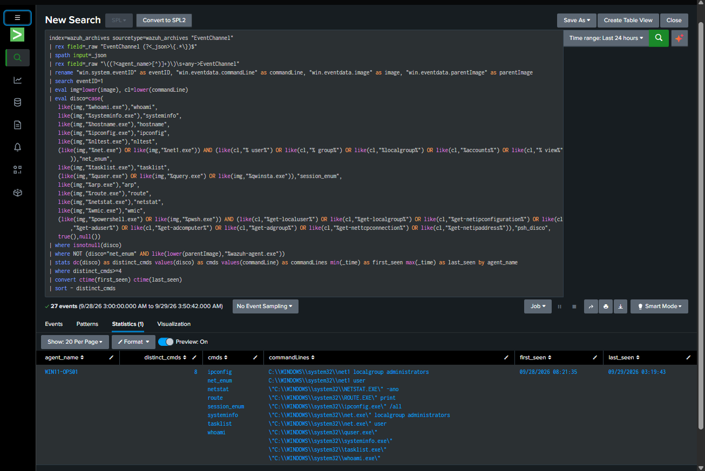
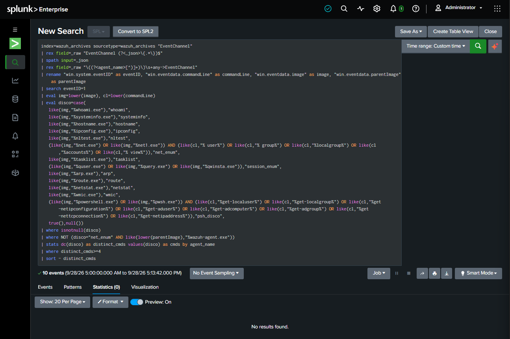
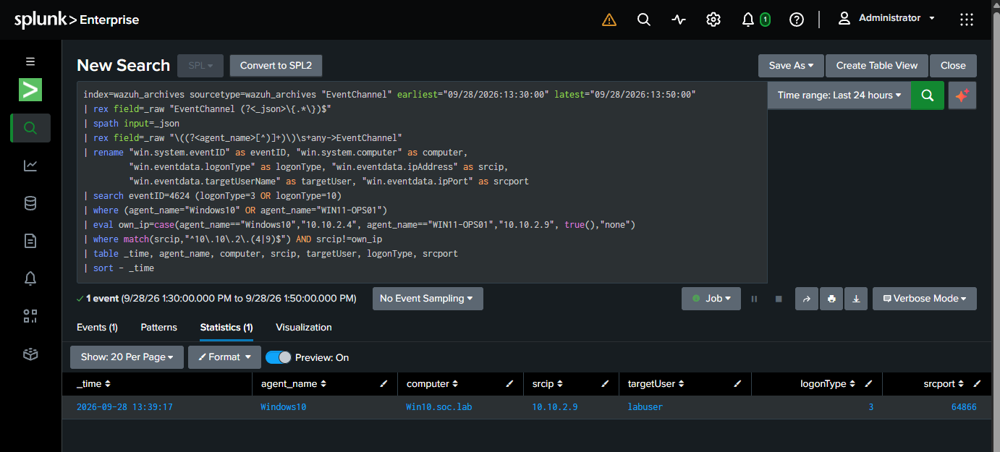
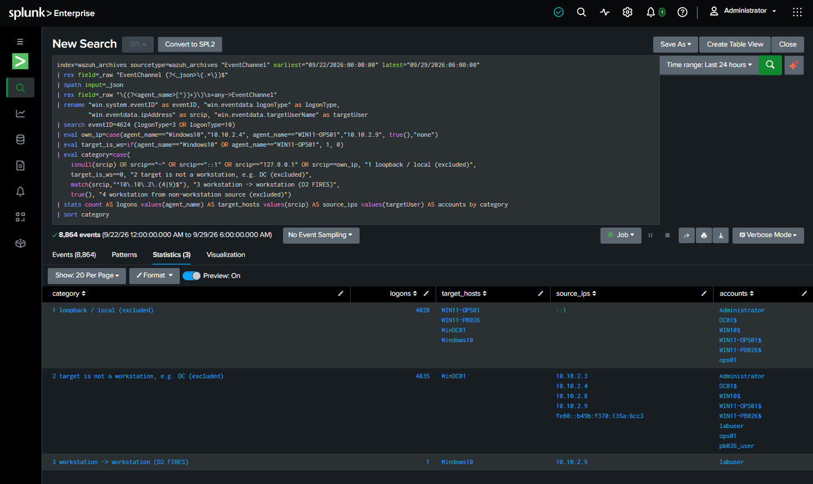

# Detections

Every detection here started as a finding from a purple-team operation, and every
one has tests: attack events it **must fire on** and normal events it **must
stay quiet on**. CI runs the tests on every change.

[:material-github: Browse the rules on GitHub](https://github.com/dotslashtag/cyber-defense-lab/tree/main/detections){ .md-button .md-button--primary }

## From a miss to a tested detection

In OP-002 and OP-003, three things got past the SOC. OP-004 turned each one into a
deployed detection:

| | What happened | Why nothing alerted | The fix |
|---|---|---|---|
| **D1** | Attacker ran native discovery (`whoami`, `net`, `nltest`, `systeminfo`...) | Each command is normal on its own; existing rules looked for attacker tools, not behaviour | Alert when **4+ different discovery tools** run on one host within 10 minutes |
| **D2** | Attacker hopped from one workstation to another with valid credentials | The lateral-movement rule only watched traffic from the attack network | Alert on any **network or RDP logon between two workstations** |
| **D3** | A Run-key persistence alert fired on `reg.exe` | The alert title said "script host", which pointed the analyst the wrong way | Renamed the alert to "Run/RunOnce Key Modified", showing the actual writer |

Each was validated **both ways** in the lab before being enabled:

- **D1** fired at 8 distinct tools on a replayed discovery burst; the busiest normal
  10-minute window on any host had 1.
- **D2** caught the OP-003 hop, and only that: of 8,864 network/RDP logons over 7 days,
  4,028 were loopback and 4,835 went to the domain controller, leaving exactly 1.

<div class="grid" markdown>

<figure markdown>

<figcaption>D1 fires on the replayed OP-002 discovery burst (8 categories, threshold 4).</figcaption>
</figure>

<figure markdown>

<figcaption>The same search over a normal window: no results.</figcaption>
</figure>

</div>

<div class="grid" markdown>

<figure markdown>

<figcaption>D2 fires on the OP-003 hop: Windows10 ← 10.10.2.9 as <code>labuser</code>, type 3.</figcaption>
</figure>

<figure markdown>

<figcaption>Selectivity over 7 days: 8,864 logons, of which only 1 is workstation → workstation.</figcaption>
</figure>

</div>

A **blind re-run** on 2026-09-30 then caught both D1 and D2 cold, in about 5 and 6
minutes. See [Results](../operations/results.md).

## Inventory

| Detection | ATT&CK | Formats | Origin |
|---|---|---|---|
| Clustered native discovery (D1) | T1033 · T1082 · T1016 · T1057 · T1087 · T1018 | Splunk · Sigma correlation | OP-002 → OP-004 |
| Workstation-to-workstation logon (D2) | T1021.002 · T1550.002 · T1078 | Splunk · Sigma | OP-003 → OP-004 |
| Run/RunOnce key written by script host or LOLBin (D3) | T1547.001 | Splunk · Sigma | OP-002 → OP-004 |
| Run/RunOnce key written by a script host | T1547.001 | Wazuh `510150` | PB-012 · OP-001 |
| PowerShell with ExecutionPolicy Bypass | T1059.001 | Wazuh `510140` · Sigma | PB-003 |
| Defender Tamper Protection blocked a change | T1562.001 | Wazuh `510142` · Sigma | PB-005 · OP-001 |
| Rundll32 spawned by PowerShell | T1218.011 | Wazuh `510143` · Sigma | PB-009 |
| Connection to a controlled IOC IP | (none on purpose) | Wazuh `510144` | PB-010 · PB-017 · PB-019 |
| Brute force, password spray, lockout, success-after-brute-force | T1110.001 · T1110.003 · T1078 | Wazuh `510120`–`510122`, `510130`–`510133` | PB-001 · PB-002 |

## Example: D2 in Sigma

```yaml
detection:
  selection_logon:
    EventID: 4624
    LogonType: [3, 10]
  selection_target_workstation:
    Computer: ['Win10.soc.lab', 'WIN11-OPS01.soc.lab', 'WIN11-PB026.soc.lab']
  selection_source_workstation:
    IpAddress: ['10.10.2.4', '10.10.2.9', '10.10.2.8']
  filter_loopback:
    IpAddress: ['127.0.0.1', '::1', '-']
  condition: all of selection_* and not filter_loopback
```

And its tests: the OP-003 hop must fire; a workstation logging on to the domain
controller, a loopback logon, a console logon and a failed logon must not.

## How the testing works

- **Sigma** rules are parsed by [pySigma](https://github.com/SigmaHQ/pySigma),
  converted to Splunk, and checked against their sample events by a small evaluator
  built on pySigma's own parser. The correlation rule is tested with a sliding
  10-minute window, including a burst that crosses a clock boundary.
- **Wazuh** rules are checked for unique IDs in the lab's range, a parent rule and
  an ATT&CK tag, and their field patterns are run against sample alerts.
- To show the tests catch mistakes, I broke rules on purpose (dropped an
  exclusion, raised a threshold, changed a process name). Each change made a test fail.

!!! warning "Known issues I found in my own rules"
    Publishing the live Wazuh file meant reading it line by line, then testing each
    rule live. `510140` (ExecutionPolicy Bypass) turned out to be **silently dead** on
    the newest endpoint: another rule pack had taken over its parent event, so it was
    never evaluated. Four more rules had the same outcome for other reasons:
    `510130`/`510131` (brute force, spray) compared a source-IP field Wazuh never
    fills in on Windows events; `510122` (lockout) hung off the logon-*success* rule,
    which lockout events never reach; and `510132` ("successful login after brute
    force") never checked for a successful logon at all. All are fixed and
    re-validated live (2026-10-12), as is `510133`, which was labelled "lateral
    movement" but only counted three failed logons; it is now an honest
    low-severity brute-force early warning. Each finding is written up with its
    fixes in the [detections README](https://github.com/dotslashtag/cyber-defense-lab/blob/main/detections/README.md#wazuh-rule-review).

!!! note "Limits"
    D2 v2 (2026-10-13) reads its workstations from a lookup and caught a live
    WIN11-PB026 → Windows10 hop that v1 would have missed. Testing also found that
    WIN11-OPS01 was cloned from PB026 without Sysprep (same machine SID), so logons
    between those two fail; that is a lab fix on the backlog, not a detection gap.
    The Wazuh parent rule and decoder only run on a real Wazuh manager, and the
    Splunk searches were validated against live lab data rather than in CI. Sample
    events are representative events based on lab validation runs, not raw log exports.
