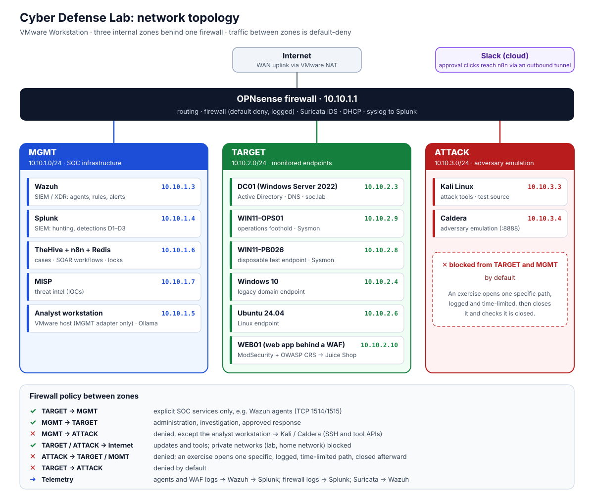
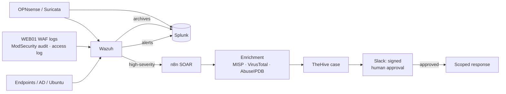

# Architecture

<!-- PAGE: Architecture
     On the site: https://dotslashtag.github.io/cyber-defense-lab/lab/architecture/
     Menu: The Lab > Architecture -->

## Network topology

<!-- PICTURE: docs/assets/img/network-topology.svg (click to enlarge). Lab IPs are fictional
     10.10.x.x values; update the SVG if a host or zone changes. -->

The whole lab runs on one workstation under VMware Workstation. Each zone is its own virtual
network, and all traffic between zones goes through the OPNsense firewall, which sends its logs to
Splunk. The workstation also runs the local AI model (Ollama) used for alert triage.

## Security zones

| Zone | Purpose |
|---|---|
| **WAN** | Internet uplink for OPNsense |
| **MGMT** | SOC infrastructure: Wazuh, Splunk, n8n, TheHive, MISP |
| **TARGET** | Monitored endpoints: domain controller, Windows and Linux hosts, and WEB01, a deliberately vulnerable web app (OWASP Juice Shop) behind a ModSecurity WAF with the OWASP Core Rule Set |
| **ATTACK** | Kali and Caldera adversary systems |

Traffic between zones is **default-deny**. Paths opened for an exercise are
logged and time-limited, then closed (disabled or removed) and checked closed
afterward.

**Hardened 2026-11-09.** A review found two ways around the firewall: VMware host
adapters on the TARGET and ATTACK networks, and a VMware NAT adapter on Kali, which
together gave the attack VM an unfiltered path to TARGET, the host and the home network.
Now:

- Every lab VM has **one network adapter**, on its own zone. No VMware NAT or bridged
  adapters; only the firewall's WAN uses NAT.
- The analyst workstation sits on **MGMT only** and reaches TARGET and ATTACK through
  OPNsense. Its access into ATTACK is limited to SSH and the tool APIs on Kali and Caldera.
- TARGET and ATTACK reach the internet, but **not private networks**: no other lab zone
  and not the home network. Only the firewall itself uses the home DNS servers.

## Data flow

- **Two Splunk indexes from Wazuh:** `wazuh` (alerts) and `wazuh_archives` (every
  event). Archives are what make hunting for "logged but not alerted" activity possible.
- **Network telemetry takes two paths:** Suricata → Wazuh, and OPNsense firewall
  logs → Splunk.
- **Response is gated:** n8n can enrich, open cases and recommend, but containment
  (for example disabling an account or blocking an IP) only runs after an authorized
  analyst approves it in Slack.
