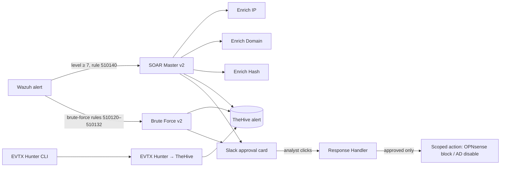

# Approval-Gated SOAR

<!-- PAGE: Approval-Gated SOAR
     On the site: https://dotslashtag.github.io/cyber-defense-lab/lab/soar/
     Menu: The Lab > Approval-Gated SOAR -->

The lab's automation does everything **up to the decision**. It enriches alerts, opens a case
and recommends an action. **A human makes the call** in Slack. No workflow contains, blocks or
disables anything on its own.

<!-- BUTTONS: edit the text in [ ] and the link in ( ); keep { .md-button } -->
[:material-github: The 7 workflows (sanitized JSON)](https://github.com/dotslashtag/cyber-defense-lab/tree/main/n8n-workflows){ .md-button .md-button--primary }

## How the pieces fit

## The workflows

| Workflow | Triggered by | What it does | Where a human decides |
|---|---|---|---|
| **SOAR Master v2** | Wazuh alert to a token-protected webhook | Normalizes, removes duplicates (Redis), classifies, pulls Splunk context, enriches observables through the three sub-workflows, gets a local AI triage note (Ollama), opens a TheHive alert, notifies Slack | Approval-tier alerts get a Slack approval card. Nothing is contained automatically |
| **Brute Force v2** | Wazuh brute-force and spray rules (510120–510122, 510130–510132) | Safety gate (allow-listed rules, protected accounts), 15-minute de-duplication, TheHive alert (severity 4 for the possible-compromise rule 510132), Slack approval card | Approve the routine actions, approve a named-account exception, Reject, or Investigate, all in Slack |
| **Response Handler** | A button click on a Slack approval card | Verifies Slack's signature, checks the clicker is an authorized approver, takes a one-time approval lock, then runs only the approved, policy-permitted action. Updates Slack and logs to TheHive | The signed click **is** the authorization. Host isolation is disabled |
| **Enrich IP / Domain / Hash** | Called by SOAR Master v2 | Validates the observable, looks for recent sightings in Splunk and matches in MISP, and returns a normalized result | n/a (read-only) |
| **EVTX Hunter → TheHive** | The [EVTX Hunter](../tools/evtx-hunter.md) CLI | Validates the report, caps findings, opens one TheHive alert per report with a deterministic `sourceRef` (duplicates are refused) | The analyst triages the alert. No response action |
| **Automation Failure Alert** | Any of the seven workflows above failing (n8n Error Workflow) | Posts one short Slack message: workflow, failed node, trimmed error text, execution ID and time. No alert data. A storm guard sends at most one message per workflow and node every 10 minutes | The analyst follows up. The failed alert itself is still in Wazuh and Splunk |

## Design choices

- **No automatic containment.** A false positive would lock out a real user. And if repeated
  failed logins disabled accounts automatically, an attacker could fail logins on purpose to lock
  out the admins, turning the automation into a denial-of-service tool.
- **Approvals are verified, not trusted.** The Response Handler checks Slack's HMAC-SHA256
  signature with a constant-time comparison and a 5-minute replay window, using a key stored
  outside the workflow. It then checks the clicking user against an allow-list.
- **Blast radius is limited even after approval.** There are two approval paths, and the
  handler re-checks Active Directory live before any change:
    - **Routine:** the account must be a direct member of `SOC-SOAR-Disable-Eligible`.
    - **Exception:** a separate, explicitly labelled button for one named account outside that
      group. The analyst has to choose it on purpose.

  Both paths refuse:
    - protected names (Administrator, krbtgt and others);
    - `svc_` accounts and any account with a service principal name;
    - accounts flagged `adminCount`;
    - members of privileged groups such as Domain Admins;
    - accounts that are already disabled.

  IP blocking is limited to the controlled simulation source. Host isolation is off.
- **Each decision runs once.** A Redis lock makes a second click on the same card a no-op.
- **Failures are loud.** The workflows fail closed: if a safety step like de-duplication can't
  be verified, they stop instead of acting. Every one of them is wired to the Automation Failure
  Alert, so a stopped run reaches Slack instead of sitting silently in n8n. The alert itself fails
  *open*: if Redis is down, it still sends, because a missed failure alert is worse than a
  duplicate one.
- **De-duplication everywhere.** Repeated alerts within 15 minutes do not create new cases.
  TheHive refuses a second alert with the same `sourceRef`.
- **Reusable enrichment.** IP, domain and hash lookups are separate sub-workflows, so every
  intake path enriches observables the same way.

## How it was tested, honestly

- Each workflow was validated in the lab with **synthetic alerts** sent to its webhook. Each
  test confirmed the TheHive alert, the Slack card and the Reject path.
- The EVTX Hunter path was tested with real lab logs: one alert created, one duplicate refused.
- **Still on the backlog:** a full end-to-end brute-force test from the attacker zone, with
  Kali against a Windows login, then Wazuh, then n8n.

## Publishing

The exports were cleaned with a sanitizer before publishing
([`n8n-workflows/sanitize.py`](https://github.com/dotslashtag/cyber-defense-lab/blob/main/n8n-workflows/sanitize.py)).
It removes IDs, credentials, Slack channel and user IDs, and anything that looks like a secret.
CI re-checks every published file. Lab IP addresses (`10.10.x.x`) are kept, because they are
fictional lab values.
