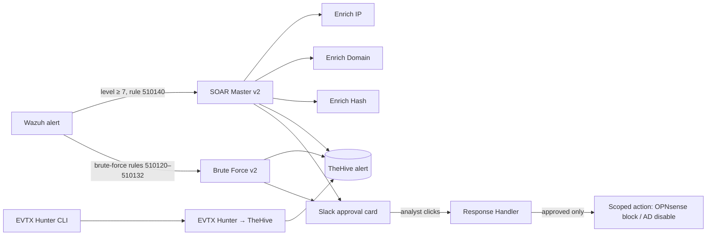
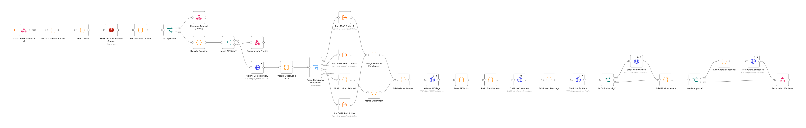
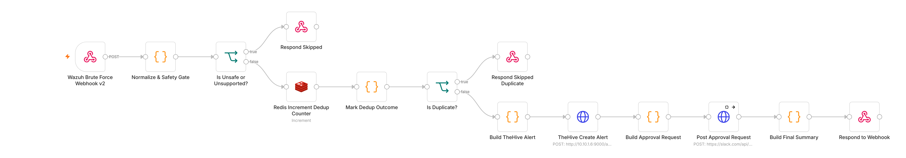
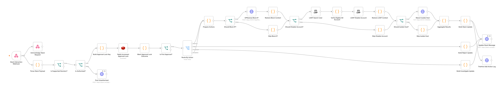
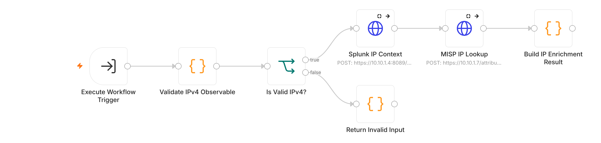
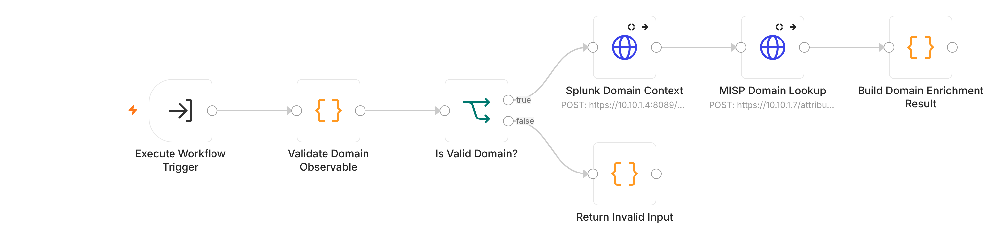
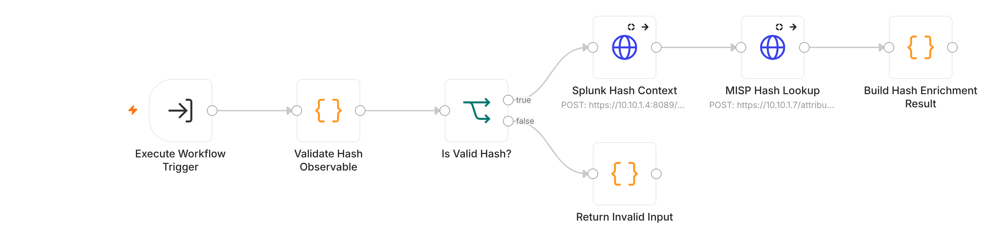
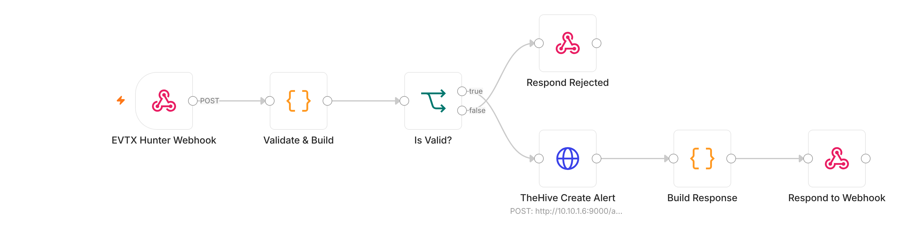
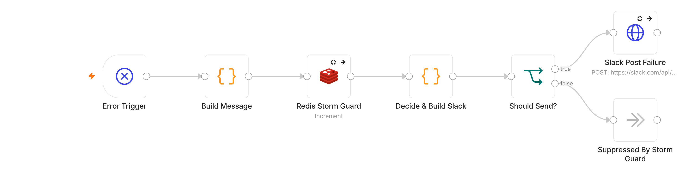

# Approval-Gated SOAR

<!-- PAGE: Approval-Gated SOAR
     On the site: https://dotslashtag.github.io/cyber-defense-lab/lab/soar/
     Menu: The Lab > Approval-Gated SOAR -->

The lab's automation does everything **up to the decision**. It enriches alerts, opens a case
and recommends an action. **A human makes the call** in Slack. No workflow contains, blocks or
disables anything on its own.

<!-- BUTTONS: edit the text in [ ] and the link in ( ); keep { .md-button } -->
[:material-github: The 8 workflows (sanitized JSON)](https://github.com/dotslashtag/cyber-defense-lab/tree/main/n8n-workflows){ .md-button .md-button--primary }

## How the pieces fit

## The workflows

| Workflow | Triggered by | What it does | Where a human decides |
|---|---|---|---|
| **SOAR Master v2** | Wazuh alert to a token-protected webhook | Normalizes, removes duplicates (Redis), classifies, pulls Splunk context, enriches observables through the three sub-workflows, gets a local AI triage note (Ollama), opens a TheHive alert, notifies Slack | Approval-tier alerts get a Slack approval card. Nothing is contained automatically |
| **Brute Force v2** | Wazuh brute-force and spray rules (510120–510122, 510130–510132) | Safety gate (allow-listed rules, protected accounts), 15-minute de-duplication, TheHive alert (severity 4 for the possible-compromise rule 510132), Slack approval card | Approve the routine actions, approve a named-account exception, Reject, or Investigate, all in Slack |
| **Response Handler** | A button click on a Slack approval card | Verifies Slack's signature, checks the clicker is an authorized approver, takes a one-time approval lock, then runs only the approved, policy-permitted action. Updates Slack and logs to TheHive | The signed click **is** the authorization. Host isolation is disabled |
| **Enrich IP / Domain / Hash** | Called by SOAR Master v2 | Validates the observable, looks for recent sightings in Splunk and matches in MISP, and returns a normalized result | n/a (read-only) |
| **EVTX Hunter → TheHive** | The [EVTX Hunter](../tools/evtx-hunter.md) CLI | Validates the report, caps findings, opens one TheHive alert per report with a deterministic `sourceRef` (duplicates are refused) | The analyst triages the alert. No response action |
| **Automation Failure Alert** | Any of the seven workflows above failing (n8n Error Workflow) | Posts one short Slack message: workflow, failed node, trimmed error text, execution ID and time. No alert data. A storm guard sends at most one message per workflow and node every 10 minutes | The analyst follows up. The failed alert itself is still in Wazuh and Splunk |

## What they look like in n8n

<!-- SCREENSHOTS: made from the sanitized JSON files in a throwaway local n8n (same version),
     never from the live instance, then auto-arranged with n8n's "Tidy up". Click to enlarge. -->

Each picture is the workflow's canvas, made from the published JSON file, so you can follow the
flow without importing it. Click a picture to enlarge it, or open a **Step by step** box
under the three main workflows: each follows one example alert through every step. The three big workflows also have an
**Open full size** link: it opens the picture in a new tab, where you can zoom in on the labels.

### SOAR Master v2

[:material-magnify-plus-outline: Open full size](../assets/img/n8n/soar-master-v2.png){ target="_blank" }

??? example "Step by step, with an example: SOAR Master v2"

    <!-- STEP-BY-STEP BOX: "???" makes it collapsible (closed by default). Everything inside must
         stay indented by 4 spaces. Example values are illustrative, not from a real incident. -->

    **The story:** on the lab workstation `WIN11-PB026`, the user `jdoe` runs
    `powershell.exe -ep bypass -File C:\Users\Public\update.ps1`. Wazuh fires the lab's custom
    rule with **rule ID `510140`** ("Suspicious PowerShell launched with ExecutionPolicy Bypass",
    **rule level 10** on Wazuh's 0–15 scale, rule groups `powershell`, `execution_policy_bypass`, `windows`) and sends the
    alert here.

    | # | Step | What it checks or does | In the example |
    |---|---|---|---|
    | 1 | **Webhook** | Receives the Wazuh alert through the token-protected proxy | The alert for rule ID `510140` from `WIN11-PB026` arrives |
    | 2 | **Parse & Normalize** | Pulls out rule ID, rule level, host, user, IPs, command line, domain, hash | Rule ID: `510140` Rule level: `10` Host: `WIN11-PB026` User: `jdoe` Command line: `powershell.exe -ep bypass -File C:\Users\Public\update.ps1` IP address, domain, hash: none |
    | 3 | **De-duplication** (Redis) | Has this exact alert arrived in the last 5 minutes? If Redis can't answer, stop (fail closed) | First time: continue |
    | 4 | **Classify Scenario** | Sorts the alert into a scenario and severity using its rule groups and rule level. Rule level 7 or higher goes on to triage; lower gets a "low priority" reply | The rule groups include `windows`, and the rule ID `510140` starts with `510` (the lab's own custom rules) → scenario **WINDOWS_HIGH**. Rule level 10 is below 14 → severity **high**. Rule level 10 is 7 or higher → on to triage |
    | 5 | **Splunk context** | Asks Splunk what else this host did in the last 30 minutes | Finds the other recent alerts from `WIN11-PB026` |
    | 6 | **Enrichment** | If the alert has an IP, domain or hash, calls the matching Enrich sub-workflow (Splunk sightings + MISP threat intel) | Nothing to look up → skipped |
    | 7 | **AI triage** (local Ollama) | A local model writes a verdict, confidence and short summary. It **cannot authorize anything** | "Suspicious, 85% confidence, escalate" |
    | 8 | **Approval tier** | Confidence 70% or more **and** "escalate" → an approval card. Otherwise manual only | 85% + escalate → **approval card** |
    | 9 | **TheHive alert** | Opens the case with the summary, enrichment health and observables | Title: `[SOAR] WINDOWS_HIGH: Suspicious PowerShell launched with ExecutionPolicy Bypass.` Severity: `3` (high) |
    | 10 | **Slack notifications** | Posts to the alerts channel, and also to the critical channel when severity is high or critical | Posted to both |
    | 11 | **Approval card** | Buttons: *Approve Allowed Actions*, *Reject*, *Investigate First*. The **only** action it can ever allow is a firewall block of a source IP that MISP confirms as a known threat | No such IP → card says **"Allowed containment: None"**. The analyst investigates |

    **The point of the example:** the AI said "escalate", but the AI never decides what is
    allowed. Fixed code does, based on evidence (a MISP match). Had the alert come from an
    external IP listed in MISP, the card would have offered to block that one IP, and nothing else.

### Brute Force v2

[:material-magnify-plus-outline: Open full size](../assets/img/n8n/brute-force-v2.png){ target="_blank" }

??? example "Step by step, with an example: Brute Force v2"

    <!-- STEP-BY-STEP BOX (collapsible). Same story continues in the Response Handler box. -->

    **The story:** the lab's Kali machine (`10.10.3.3`, the controlled attack source) guesses
    passwords for the test account `jdoe` on `WIN11-PB026`. After 8 failures in 2 minutes, Wazuh
    fires the lab's custom rule with **rule ID `510130`** ("Behavior: Brute force detected",
    **rule level 12**).

    | # | Step | What it checks or does | In the example |
    |---|---|---|---|
    | 1 | **Webhook** | Receives only the 6 brute-force rule IDs (`510120`–`510122`, `510130`–`510132`), through the token-protected proxy | The alert for rule ID `510130` arrives |
    | 2 | **Normalize & Safety Gate** | Skips the alert unless: the rule ID is one of the 6; the rule level is 10 or more; the account is not protected (`administrator`, `admin`, `guest`, `krbtgt`, `root`, or the SOC tool accounts `wazuh`, `splunk`, `thehive`, `n8n`), is not a computer account (a name ending in `$`) and is not missing; the source is a valid IPv4 address | Rule ID `510130`: allowed Rule level `12`: 10 or more Account `jdoe`: not protected Source `10.10.3.3`: valid IPv4 → all checks pass |
    | 3 | **De-duplication** (Redis) | Has this exact event arrived in the last 15 minutes? If Redis can't answer, stop (fail closed) | First time: continue |
    | 4 | **TheHive alert** | Opens the case. Rule ID `510132` (logon *succeeded* after brute force) gets severity 4, the other five get 3 | Title: `[REVIEW REQUIRED] Brute Force: jdoe from 10.10.3.3` Severity: `3` |
    | 5 | **Approval card** | No case ID from TheHive → no card. The card lists exactly what each button may do. An IP block is offered **only** for the controlled test IP `10.10.3.3` | Card offers: block `10.10.3.3`; disable `jdoe` *if* it is in `SOC-SOAR-Disable-Eligible` |
    | 6 | **Reply to Wazuh** | Confirms receipt | Done. **Nothing has been changed yet** |

    The four buttons: *Approve Routine Actions*, *Approve Account Disable (Exception)*, *Reject*,
    *Investigate*. The story continues when the analyst clicks: see the Response Handler below.

### Response Handler (Slack approval)

[:material-magnify-plus-outline: Open full size](../assets/img/n8n/response-handler-slack-approval.png){ target="_blank" }

??? example "Step by step, with an example: Response Handler"

    <!-- STEP-BY-STEP BOX (collapsible). Continues the Brute Force v2 story above. -->

    **The story continues:** the approver `@analyst` clicks **Approve Routine Actions** on the
    `jdoe` card. One second later a colleague clicks the same button.

    | # | Step | What it checks or does | In the example |
    |---|---|---|---|
    | 1 | **Acknowledge** | Replies "OK" to Slack at once (Slack shows an error after 3 seconds) | Slack is happy |
    | 2 | **Verify the signature** | Slack signs every click with a secret only n8n knows (HMAC-SHA256). Recomputed and compared in constant time; clicks older than 5 minutes are refused | Genuine and fresh: continue. A forged click would stop here |
    | 3 | **Known button?** | Only the 4 approval buttons are accepted | Approve Routine Actions: OK |
    | 4 | **Approver?** | The clicker must be on the approver list; anyone else gets "Unauthorized" in the thread | `@analyst` is on the list |
    | 5 | **One-time lock** (Redis) | The first decision on a card wins; later clicks stop quietly | First click runs. **The colleague's click stops here** |
    | 6 | **Prepare Actions** | Re-checks the card's policy: which actions are allowed, for which IP and account. Host isolation is always off | Block `10.10.3.3`: allowed. Disable `jdoe`: allowed, routine mode |
    | 7 | **OPNsense block** | Adds the IP to the firewall alias `SOC_BRUTE_BLOCK` | `10.10.3.3` is blocked |
    | 8 | **Live AD checks → disable** | Looks the account up in Active Directory **now** and refuses if it is already disabled, flagged `adminCount`, has a service principal name, is in a privileged group, or (routine mode) is not in `SOC-SOAR-Disable-Eligible` | `jdoe` passes → disabled |
    | 9 | **Update Slack + TheHive** | Rewrites the card with ✅ / ❌ / ➖ per action and logs who approved what in TheHive | Card: ✅ Block IP, ✅ Disable account, ➖ Isolate host (skipped) |

    **What if** `jdoe` had been added to Domain Admins after the alert? Step 8 refuses, nothing
    changes in AD, and the failure alert tells the team why.

### Enrich IP, Domain and Hash

### EVTX Hunter → TheHive

### Automation Failure Alert

## Design choices

- **No automatic containment.** A false positive would lock out a real user. And if repeated
  failed logins disabled accounts automatically, an attacker could fail logins on purpose to lock
  out the admins, turning the automation into a denial-of-service tool.
- **Approvals are verified, not trusted.** The Response Handler checks Slack's HMAC-SHA256
  signature with a constant-time comparison and a 5-minute replay window, using a key stored
  outside the workflow. It then checks the clicking user against an allow-list.
- **Blast radius is limited even after approval.** There are two approval paths, and the
  handler re-checks Active Directory live before any change:
    - **Routine:** the account must be a direct member of `SOC-SOAR-Disable-Eligible`.
    - **Exception:** a separate, explicitly labeled button for one named account outside that
      group. The analyst has to choose it on purpose.

  Both paths refuse:
    - protected names (Administrator, krbtgt and others);
    - `svc_` accounts and any account with a service principal name;
    - accounts flagged `adminCount`;
    - members of privileged groups such as Domain Admins;
    - accounts that are already disabled.

  IP blocking is limited to the controlled simulation source. Host isolation is off.
- **Each decision runs once.** A Redis lock makes a second click on the same card a no-op.
- **Failures are loud.** The workflows fail closed: if a safety step like de-duplication can't
  be verified, they stop instead of acting. Every one of them is wired to the Automation Failure
  Alert, so a stopped run reaches Slack instead of sitting silently in n8n. The alert itself fails
  *open*: if Redis is down, it still sends, because a missed failure alert is worse than a
  duplicate one.
- **De-duplication everywhere.** The same alert arriving again within 5 minutes (SOAR Master)
  or 15 minutes (Brute Force v2) does not create a new case. TheHive refuses a second alert with
  the same `sourceRef`.
- **Reusable enrichment.** IP, domain and hash lookups are separate sub-workflows, so every
  intake path enriches observables the same way.

## How it was tested, honestly

- Each workflow was validated in the lab with **synthetic alerts** sent to its webhook. Each
  test confirmed the TheHive alert, the Slack card and the Reject path.
- The EVTX Hunter path was tested with real lab logs: one alert created, one duplicate refused.
- **Still on the backlog:** a full end-to-end brute-force test from the attacker zone, with
  Kali against a Windows login, then Wazuh, then n8n.

## Publishing

The exports were cleaned with a sanitizer before publishing
([`n8n-workflows/sanitize.py`](https://github.com/dotslashtag/cyber-defense-lab/blob/main/n8n-workflows/sanitize.py)).
It removes IDs, credentials, Slack channel and user IDs, and anything that looks like a secret.
CI re-checks every published file. Lab IP addresses (`10.10.x.x`) are kept, because they are
fictional lab values.
