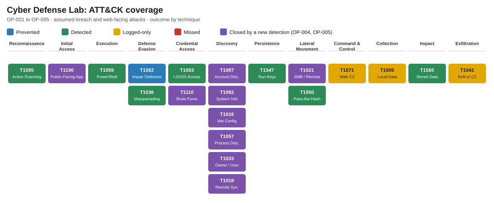

# Purple-Team Operations

<!-- PAGE: Operations (section front page)
     On the site: https://dotslashtag.github.io/cyber-defense-lab/operations/
     Menu: Operations -->

Purple-team operations run with MITRE Caldera and Kali. OP-001 to OP-004 are
assumed-breach emulations: each starts **after** initial access and exercises the later
stages (execution, defense evasion, discovery, persistence, C2, lateral movement,
collection and exfiltration). OP-005 attacks from **outside**: reconnaissance and
exploitation attempts against a web application behind a WAF.

Outcomes are scored honestly:
🟦 Prevented · 🟩 Alerted · 🟨 Logged-only · 🟥 Missed

## The five operations

| Operation | What it tested | Headline finding |
|---|---|---|
| **OP-001** Commodity Intrusion Chain | A 7-phase chain from execution to exfiltration | Defender **prevented** the stock agent by cloud reputation; a Run-key persistence gap surfaced (Wazuh silent, Splunk compensating) and was later fixed |
| **OP-002** Stealth Tradecraft Variant | The same chain, run quietly with built-in Windows tools | Detection was **tied to known tools and IOCs, not to attacker intent**: native discovery, sustained C2 and non-IOC exfiltration went unalerted |
| **OP-003** Lateral Movement / Multi-Host | Foothold → peer workstation with valid credentials | A **detection blind spot but a prevention success**: no alert on the hop, but the host firewall and token filtering blocked execution |
| **OP-004** Detection-Engineering Loop | Turn the OP-002/003 misses into detections | Three new detections deployed and validated both ways. The loop, closed |
| **OP-005** Web Application Attack | Recon, content discovery, SQL injection, XSS and login guessing against OWASP Juice Shop behind ModSecurity + OWASP CRS | Network signatures caught recon, scanning and XSS, and nginx blocked path traversal, but **the WAF's own verdicts never raised an alert**: SQL injection that reached the database read as a generic server error, and a login burst as per-request errors. Built **W1** and **W5**; the SQLi retest now alerts |

## ATT&CK coverage

<!-- LAYOUT: full-width image. Keep the <figure> lines; edit the image path ( ) or the caption text -->
<figure class="cdl-wide" markdown>

<figcaption>Outcome per technique across OP-001 to OP-005. Purple = closed by a new detection (OP-004, OP-005).</figcaption>
</figure>

| Tactic | Technique | Outcome | Coverage now |
|---|---|---|---|
| Reconnaissance | T1595 · T1595.003 Active scanning | 🟩 Alerted (Suricata signatures) · 🟨 scan volume itself | ⛏ Backlog: W4, requests per source |
| Initial Access | T1190 Exploit public-facing app | 🟦 traversal (nginx) · 🟩 XSS (Suricata, IOC rule) · 🟨 SQLi → 500 | ✅ Closed by W1, WAF anomaly verdict (SQLi retest: Alerted) |
| Execution | T1059.001 PowerShell | 🟩 Alerted | Stable |
| Defense Evasion | T1562.001 Disable Security Tools | 🟦 Prevented | Stable |
| Credential Access | T1003.001 LSASS access | 🟩 Alerted | Telemetry validated |
| Credential Access | T1110.001 Password guessing (web login) | 🟨 per-request errors only | ✅ Closed by W5, 8 failures per IP in 2 min |
| Discovery | T1087.002 · T1082 · T1016 · T1057 · T1033 · T1018 | 🟥 Missed (native tools) | ✅ Closed by D1, clustered discovery |
| Persistence | T1547.001 Run keys | 🟩 Alerted | ✅ Closed by D3, works for any writer |
| Lateral Movement | T1021.002 · T1550.002 · T1078 | 🟥 Missed within a zone | ✅ Closed by D2, workstation-to-workstation auth |
| Command & Control | T1071.001 Web C2 | 🟩 on connect · 🟨 sustained beacon | ⛏ Backlog: beaconing detection |
| Collection | T1005 · T1565.001 | 🟩 canary · 🟨 off-canary | ⛏ Backlog: wider file monitoring |
| Exfiltration | T1041 | 🟩 to known IOC · 🟥 unknown destination | ⛏ Backlog: IOC-independent egress |

The 🟥 and 🟨 rows are the point: each was found by a scored operation, and five have
been turned into deployed detections (D1–D3, W1, W5). The ⛏ items are a known,
prioritized backlog.

<!-- CALLOUT BOX: the !!! line sets the box style; edit the quoted title and the indented text below it -->
!!! success "Did the fixes work?"
    Yes. A blind re-run caught 4 of 5 techniques cold, including both former misses.
    See [Results](results.md).

<!-- CALLOUT BOX: the !!! line sets the box style; edit the quoted title and the indented text below it -->
!!! info "Full write-ups"
    Incident reports for OP-001, OP-002 and OP-003 are in the
    [Casebook](../casebook/index.md).
