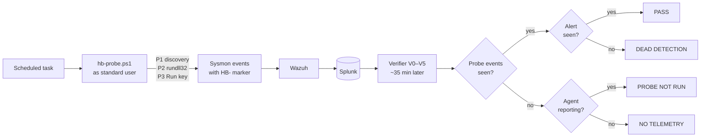

# Detection Heartbeat

<!-- PAGE: Detection Heartbeat
     On the site: https://dotslashtag.github.io/cyber-defense-lab/tools/detection-heartbeat/
     Menu: Tools > Detection Heartbeat -->

**Do my detections still work right now?** A scheduled task runs harmless, marked test
actions on a workstation. Later, Splunk searches check that every expected alert arrived.
The result tells a broken rule apart from a silent agent.

<!-- BUTTONS: edit the text in [ ] and the link in ( ); keep { .md-button } -->
[:material-github: Source and README](https://github.com/dotslashtag/cyber-defense-lab/tree/main/tools/detection-heartbeat){ .md-button .md-button--primary }

## Why

In one week the lab found six Wazuh rules that could never fire, and two agents that had
been silent for weeks. The dashboard showed the agents as **Active** the whole time. A ping
or an agent status check can't catch this. Only an end-to-end test can.

## How it works

<!-- FLOWCHART: probe → telemetry → verifier → verdict (Mermaid draws it automatically) -->

| Probe | Action | Should trip |
|---|---|---|
| P1 | `whoami`, `hostname`, `ipconfig /all`, `systeminfo`, `net user`, `tasklist`, `netstat -ano` | Splunk D1 (clustered discovery) |
| P2 | PowerShell starts `rundll32.exe` | Wazuh 510143 |
| P3 | A Run-key value pointing to `notepad.exe`, removed after 5 s | Wazuh 510150 and Splunk D3 |

A **canary**, rule `599143`, doesn't exist, so it must always report **DEAD DETECTION**.
That proves the checker itself works.

## First live run (2026-10-20, WIN11-OPS01)

| Detection | Verdict | Time to alert |
|---|---|---|
| D1 clustered discovery | PASS | ~9 min (10-minute schedule) |
| 510143 PowerShell → rundll32 | PASS | seconds |
| 510150 Run key | PASS | seconds |
| D3 Run/RunOnce key | PASS | ~4 min (5-minute schedule) |
| 599143 canary | DEAD DETECTION, as expected | — |

The probe ran as a standard user. The `-ExecutionPolicy Bypass` rule (510140) stayed silent,
and nothing reached the SOAR.

## Design choices

- **Silent when healthy.** Only failures will alert. Each failure produces one Slack message
  and one TheHive alert per host, per detection, per day.
- **A marker is never trusted on its own.** An attacker can copy it. Detection rules never
  exclude `HB-` markers. Triage checks the user, the process chain, the script path and the
  timing.
- **Every 6 hours, not hourly.** Each probe uses up the detection's per-host throttle, so a
  6-hour schedule keeps the blind window to about 8%.
- **No SOAR noise.** Detections routed to automated response (brute force, 510140) are left
  out of the unattended schedule.

## Status

Phase 1 is verified on one host. Phase 2 is next: a 6-hour schedule with automatic
verification, where failures go to Slack and TheHive.
