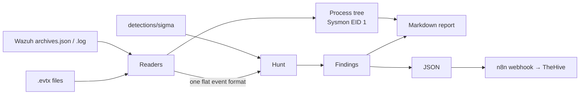

# EVTX Hunter

<!-- PAGE: EVTX Hunter
     On the site: https://dotslashtag.github.io/cyber-defense-lab/tools/evtx-hunter/
     Menu: Tools > EVTX Hunter -->

**Triage Windows event logs from the command line:** run the lab's Sigma rules
over `.evtx` exports or Wazuh archives, rebuild the process tree, and get a report
an analyst can attach to a case, or send the findings straight to n8n.

<!-- BUTTONS: edit the text in [ ] and the link in ( ); keep { .md-button } -->
[:material-github: Source and README](https://github.com/dotslashtag/cyber-defense-lab/tree/main/tools/evtx-hunter){ .md-button .md-button--primary }
[:material-file-document: Full sample report](https://github.com/dotslashtag/cyber-defense-lab/blob/main/tools/evtx-hunter/samples/op002-style-report.md){ .md-button }

## Why I built it

In OP-002, native discovery was **logged but not alerted**. Finding it meant
writing searches by hand over the archive index, and two of those searches
returned false zeros. I wanted a repeatable way to take a host's logs and ask
"what here matches what I know attackers do?", using the same tested rules
that run in the SIEM.

## What it looks like

Run against the synthetic OP-002-style sample (26 events, 2 hosts):

```text
$ evtx-hunter hunt samples/op002-style-archives.json
```

| Time (UTC) | Host | Level | Finding | ATT&CK |
|---|---|---|---|---|
| 09:10:05 | WIN11-OPS01 | medium | Clustered Native Discovery Activity (9 events) | T1033, T1082, T1016, T1057, T1087, T1018 |
| 09:12:00 | WIN11-OPS01 | medium | Run/RunOnce Key Modified By Script Host Or LOLBin | T1547.001 |
| 09:15:00 | WIN11-OPS01 | medium | PowerShell Launched With ExecutionPolicy Bypass | T1059.001 |
| 09:15:10 | WIN11-OPS01 | high | Rundll32 Spawned By PowerShell | T1218.011 |
| 09:16:30 | WIN11-OPS01 | high | Defender Tamper Protection Blocked A Configuration Change | T1562.001 |
| 09:20:00 | Win10 | medium | Workstation-To-Workstation Network Logon | T1021.002, T1078 |

And the process tree it rebuilds around those findings:

```text
(userinit.exe) [WIN11-OPS01.soc.lab]
  └─ 08:00:00 explorer.exe  C:\Windows\Explorer.EXE
     └─ 09:10:00 cmd.exe  "C:\Windows\system32\cmd.exe"
        ├─ 09:10:05 whoami.exe  whoami /all  ◀ Clustered Native Discovery Activity
        ├─ 09:10:09 systeminfo.exe  systeminfo  ◀ Clustered Native Discovery Activity
        │  … 7 more discovery commands …
        ├─ 09:12:00 reg.exe  reg add HKCU\…\Run /v OP002Persist …  ◀ Run/RunOnce Key Modified
        └─ 09:15:00 powershell.exe  powershell.exe -ep bypass -nop -c "iex …"  ◀ ExecutionPolicy Bypass
           └─ 09:15:10 rundll32.exe  rundll32.exe C:\Users\Public\helper.dll,Start  ◀ Rundll32 Spawned By PowerShell
```

The normal activity in the same file (OneDrive writing its own Run key, the Wazuh
agent running `net user` every 5 minutes, local and loopback logons) produces
**no findings**, and the tests check that.

## How it works



**Design decisions:**

- **One event format for two sources.** EVTX records and Wazuh JSON are both
  flattened to Sigma field names (`Image`, `CommandLine`, `TargetObject`…), so the
  rules don't care where the log came from.
- **Undoing a Wazuh quirk.** Wazuh's eventchannel decoder doubles every backslash
  (`C:\\Windows\\…`). Left alone, no path-based rule would ever match. The reader
  fixes it, and a test proves it.
- **Rules only see the right logs.** A rule written for process creation (Sysmon
  Event 1 or Security 4688) is never run against network or registry events that
  happen to have an `Image` field. Without this, rules fire on the wrong events.
- **Correlations use a sliding window.** "4 tools in 10 minutes" is checked from
  every event, not in fixed 10-minute buckets, so a burst that crosses a clock
  boundary still counts. The lab's Splunk version has exactly that weakness (noted
  in OP-004 as a v2 item).
- **Process GUIDs, not PIDs.** The tree links processes by Sysmon's ProcessGuid,
  which is never reused, unlike process IDs.
- **One engine for tests and hunts.** The evaluator that runs the
  [detection tests](../detections/index.md) is the same module that hunts here.
- **Unsupported means error.** If a rule uses a Sigma feature the evaluator
  doesn't understand, it raises an error instead of silently not matching.

## Send findings to TheHive through n8n

In the lab, one `--webhook` call turns a hunt into **one TheHive alert** for an analyst to
triage. It creates an alert only: no case, no responder, no containment.

```text
evtx-hunter ──HTTPS + X-Webhook-Token──▶ Nginx ingress (/ingest/evtx-hunter)
                                          │ checks the token, strips it, 5 MB body limit
                                          ▼
                                n8n "EVTX Hunter Findings → TheHive Alert"
                                          │ validate → build alert → create → respond
                                          ▼
                                TheHive alert (type evtx-hunter, TLP:AMBER)
```

**How it is built**

- **Ingress.** The same Nginx proxy that fronts the lab's Wazuh webhooks owns authentication:
  the route `/ingest/evtx-hunter` checks `X-Webhook-Token` against its own token (not the
  Wazuh one), strips it, and forwards to n8n. Direct `/webhook/evtx-hunter` paths are
  blocked, and n8n itself listens on localhost only.
- **Client.** The token comes from the `EVTX_HUNTER_WEBHOOK_TOKEN` environment variable,
  never the command line; `--ca-file` trusts the lab CA instead of disabling TLS checks.
- **n8n.** A code node rejects anything that is not an EVTX Hunter report, caps it at 50
  findings, and builds the alert: title, severity from the report's highest level, a
  Markdown table of findings, the first evidence lines as `key=value`, ATT&CK IDs as tags,
  and each host as a `hostname` observable.
- **Dedup.** The alert's `sourceRef` is a hash of the sorted `(rule, time, host)` findings, so
  sending the same report twice cannot create two alerts: TheHive refuses the second and
  the workflow answers `duplicate`.

```powershell
# Windows PowerShell 5.1 or 7: prompt for the token without echoing it
$s = Read-Host "Webhook token" -AsSecureString
$env:EVTX_HUNTER_WEBHOOK_TOKEN = [Runtime.InteropServices.Marshal]::PtrToStringBSTR([Runtime.InteropServices.Marshal]::SecureStringToBSTR($s))
evtx-hunter hunt Sysmon.evtx Security.evtx --webhook https://<proxy>/ingest/evtx-hunter --ca-file lab-ca.pem
```

**Validated live (2026-10-14)**

| Test | Result |
|---|---|
| No token / direct n8n path | 403 / 404 at the proxy |
| Synthetic sample (6 findings) | TheHive alert created, severity High, 2 host observables |
| The same report again | No second alert: TheHive refused the duplicate `sourceRef`, workflow answered `duplicate` |
| Real WIN11-OPS01 day (8,040 events) | TheHive alert created: 6 findings, 1 host |

A wrong token or an inactive workflow makes the CLI exit with code 2 and a one-line
message instead of a stack trace.

<!-- CALLOUT BOX: the !!! line sets the box style; edit the quoted title and the indented text below it -->
!!! tip "Keep the human in the loop"
    This creates an **alert**, not a response. Containment still goes through the
    lab's signed Slack approval workflow.

## Tested on real logs

On 2026-10-13 I ran EVTX Hunter on a full day of real WIN11-OPS01 events: the agent's
lines from the Wazuh manager's `archives.log`, **8,040 events** over 11 hours. The day
held known ground truth (detection tests run that morning, plus a short marked burst of
discovery, ExecutionPolicy bypass, rundll32 and a Run key), so every finding could be
checked.

| Time (UTC) | Finding | Ground truth | Verdict |
|---|---|---|---|
| 00:40:14 | Run key modified by `reg.exe` (`…\Run\D3v2Test`) | D3 v2 validation write | ✅ true positive |
| 01:31:56 | Workstation-to-workstation logon from `10.10.2.9` | WIN11-OPS01 logging on to **itself** through its own IP | ❌ **false positive**, fixed (below) |
| 05:58:28 | Workstation-to-workstation logon from `10.10.2.8` | Real WIN11-PB026 → WIN11-OPS01 hop (D2 v2 test) | ✅ true positive |
| 11:28:22 | Clustered discovery: 7 tools (whoami, ipconfig, systeminfo, net, net1, tasklist, netstat) | Marked burst | ✅ true positive |
| 11:28:26 | PowerShell with `-ep bypass` | Marked burst | ✅ true positive |
| 11:28:27 | Rundll32 spawned by PowerShell (high) | Marked burst | ✅ true positive |
| 11:28:28 | Run key modified by `reg.exe` (`…\Run\EvtxHunterTest`) | Marked burst | ✅ true positive |

It also stayed quiet where it should: a `reg.exe` write to `Explorer\RunMRU` at 00:40
(the Run-key rule lists the real autostart keys only) and a burst of failed logons (no
brute-force rule in the Sigma set; Wazuh covers that).

**Two fixes came out of it**, both now in the repo with tests built from these events:

1. **The self-logon false positive.** The Splunk version of D2 drops a logon whose source
   is the host's own IP, but Sigma cannot compare two fields, so the Sigma rule could not.
   It now pairs each workstation with its own address (`filter_self_logon`).
2. **Escaped quotes in Wazuh data.** Wazuh escapes string values twice; the reader undid
   the doubled backslashes but left `\"` in front of every quote, so command lines in
   reports read `\"C:\WINDOWS\…\" -ep bypass`. It now undoes both in one pass.

## Limits

- Supports the Sigma features the lab's rules use: wildcards, `re`, `cidr`,
  numbers, and `value_count`/`event_count` correlations.
- Reading `.evtx` is slow (pure Python, about 200 events per second); for big
  exports, use the Wazuh JSON or filter first.
- Process trees need Sysmon Event ID 1.
- The bundled sample data is synthetic; see "Tested on real logs" above for a run on a
  real day of WIN11-OPS01 events. Tested against a real 2 MB Security log, the
  reader parsed all 2,261 events correctly.
- Reports are UTF-8. In Windows PowerShell 5, read them with
  `Get-Content report.md -Encoding UTF8`, or arrows and tree lines show as `→`.
